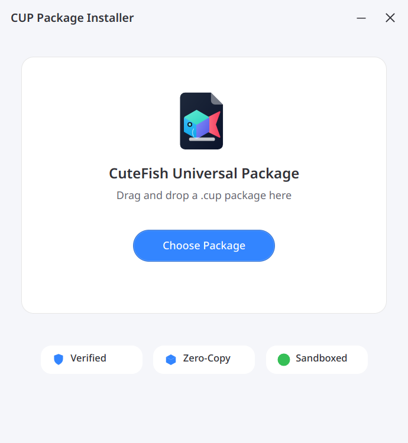
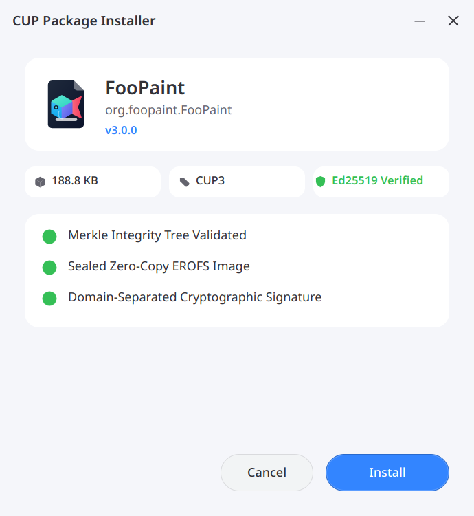
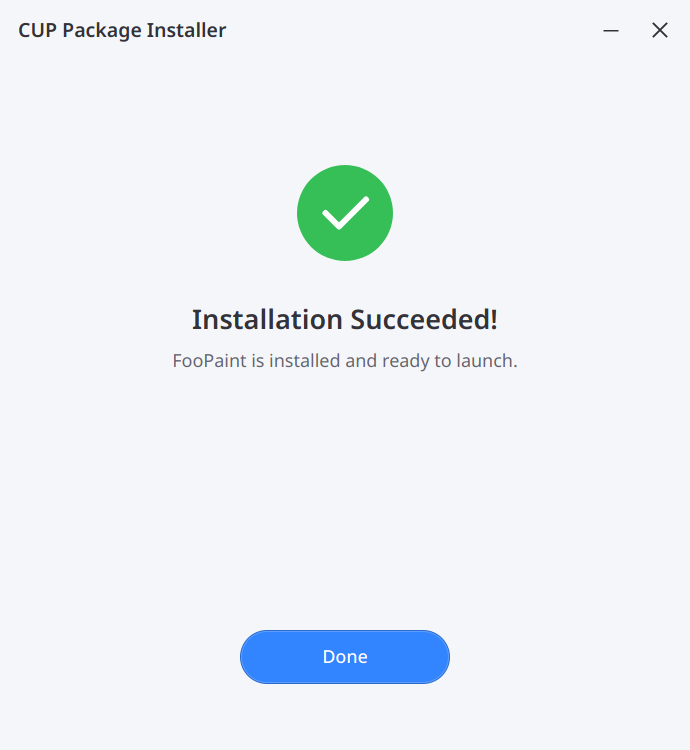

# CuteFish Universal Package (CUP v3.0)

<p align="center">
  
</p>

<p align="center">
  <b>The High-Performance, Cryptographically Sealed Application Format & Package Manager for Linux</b>
</p>

<p align="center">
  
  
  
  
  
</p>

---

## Overview

**CUP (CuteFish Universal Package)** is an ultra-fast, standalone application packaging format and runtime for Linux desktops. It unites the speed of zero-copy read-only filesystem mounts (`EROFS`), verifiable cryptographic trust chains (`Ed25519` + post-quantum slot), content-defined chunking (`FastCDC` Merkle trees), atomic rollbacks, and native kernel execution via `binfmt_misc`.

### Key Highlights

- **⚡ Instant Launch**: Zero-copy page-cache execution via `EROFS` without runtime decompress-to-disk overhead.
- **🛡️ Cryptographically Sealed**: Every byte is anchored in a Merkle tree and verified by an Ed25519 signature chain before execution.
- **🚀 Run Directly**: Execute `.cup` packages directly (`./myapp.cup`) with Linux kernel `binfmt_misc` integration.
- **🎨 Minimalist Icon-Driven GUI**: Modern, uncluttered graphical installer designed in Cutefish aesthetic with maximum icons and minimal text.
- **📦 Universal Linux Support**: Native Debian packages (`.deb`) for Debian/Ubuntu/CutefishOS and universal standalone installers for Fedora, Arch Linux, openSUSE, and more.

---

## Graphical Installer

The graphical installer is built natively with the **Cutefish Toolkit** (`cutefish-toolkit`, Skia + Wayland), delivering a fluid, modern, icon-first desktop installation experience with minimal text and maximum icons:

<p align="center">
  
  
  
</p>

---

## Repository Tree

```
cup/
├── bin/                       # Core tools and unified launcher
│   ├── cup                    # High-level CLI & direct application runner
│   ├── cup-cli                # Low-level CLI interface
│   ├── cup-gui-installer      # Graphical package installer (Cutefish Toolkit)
│   ├── cup-builder            # Container builder
│   ├── cup-installer          # Core installation backend
│   └── cup-stub               # 8.8 KiB freestanding ELF64 bootstrapper
├── c_core/                    # Hardened C23 & C++20 core engine
│   ├── libcup2.h              # Public C API header
│   ├── libcup2.c              # Core container parser, crypto, and verifier
│   ├── cup_abi_solver.hpp     # Dynamic library ABI solver
│   ├── cup_abi_solver.cpp     # ABI solver implementation
│   └── cup_stub.c             # Zero-dependency bootstrap loader
├── gui/                       # Native Cutefish Toolkit graphical installer
│   ├── src/                   # C++20 Cutefish Toolkit views & self-tests
│   ├── cmake/                 # Icon embedding toolchain (EmbedIcons.cmake)
│   └── icons/                 # Embedded vector SVG icons
├── assets/                    # Official CUP vector brand assets & logos
│   ├── cup_logo.svg           # Application squircle logo
│   ├── cup_mark.svg           # Transparent brand mark
│   └── brand.html             # Brand sheet and design tokens
├── data/                      # System integration files
│   ├── cup.xml                # Freedesktop MIME type (application/x-cup-package)
│   └── cup.conf               # Kernel binfmt_misc configuration
├── scripts/                   # Packaging and installation scripts
│   ├── package-deb.sh         # Debian (.deb) package generator
│   └── install-cup.sh         # Universal Linux installer
├── packages/                  # Reference signed demo packages
│   ├── foopaint-3.0.0-x86_64.cup
│   └── cutefish-os-calculator-1.0.0-x86_64.cup
├── spec/                      # Specification & architecture RFC
│   └── RFC_CUP_3.0_Master_Spec.md
├── tests/                     # Conformance, CLI, and hostile test harnesses
│   ├── cli_tests.py
│   └── attack.py
└── tools/                     # Verification and auditing utilities
    ├── cup-spec-lint          # Specification linter
    └── hostile_tests.c        # ASan+UBSan vulnerability regression suite
```

---

## Quick Start

### 1. Installation on Debian / CutefishOS / Ubuntu

Download the latest `.deb` release and install:

```bash
sudo dpkg -i cup-package-manager_3.0.0_amd64.deb
```

### 2. Installation on Fedora, Arch Linux, openSUSE & Others

Use the universal multi-distribution installer:

```bash
tar -xzf cup-3.0.0-linux-x86_64.tar.gz
cd cup-3.0.0-linux-x86_64
sudo ./install-cup.sh
```

---

## Using CUP Applications

### Method 1: Direct Execution (Recommended)
Make any `.cup` package executable and run it directly:

```bash
chmod +x myapp.cup
./myapp.cup --help
```

### Method 2: Unified CLI Runner
Use the `cup run` command to verify and execute packages without changing permissions:

```bash
cup run myapp.cup
```

### Method 3: System Installation
Install an application into your desktop menu and terminal `PATH`:

```bash
# Install package
cup install myapp.cup

# List installed applications
cup list

# Launch installed app
cup-myapp

# Uninstall
cup uninstall org.example.MyApp
```

### Method 4: Double-Click in File Manager
Double-clicking any `.cup` file in Cutefish File Manager, GNOME Files, or Dolphin automatically opens the **CUP Package Installer**.

---

## Building CUP Packages

To package an application into a signed `.cup` container:

```bash
cup build myapp-1.0.0-x86_64.cup \
  --app-id org.example.MyApp \
  --version 1.0.0 \
  --payload /path/to/executable
```

Verify your container:

```bash
cup verify myapp-1.0.0-x86_64.cup
```

Inspect internal sections and manifest:

```bash
cup inspect myapp-1.0.0-x86_64.cup
```

---

## Verification & Test Suite

CUP includes an exhaustive automated test battery:

```bash
# Run 400 normative conformance checks + security harness
make test

# Run 52 headless backend tests + 7 QML smoke checks
make gui-test

# Regenerate offscreen UI screenshots
make gui-screenshots
```

---

## License

CUP is distributed under the **BSD 3-Clause License**. See [LICENSE](LICENSE) for details.
Brand assets in `assets/` and `icons/` are licensed under CC BY 4.0.
